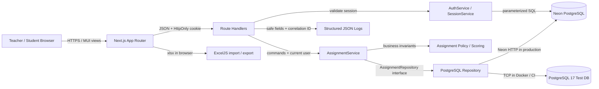

# Peerly Architecture

## App Router and feature boundaries

Next.js route files stay in `app/`: `page.tsx`, `layout.tsx` and `api/**/route.ts`. They import feature screens or HTTP handlers; feature directories do not replace Next.js routing conventions.

| Route file | Feature implementation |
| --- | --- |
| `app/page.tsx` | `features/landing/screens/landing-screen.tsx` |
| `app/login/page.tsx`, `app/register/page.tsx` | `features/auth/screens/auth-screen.tsx` |
| `app/(workspace)/layout.tsx` | `features/workspace/screens/workspace-layout.tsx` |
| `app/(workspace)/assignments/page.tsx` | `features/assignments/screens/assignment-list-screen.tsx` |
| `app/(workspace)/assignments/[id]/page.tsx` | `features/assignments/screens/assignment-detail-screen.tsx` |
| `app/(workspace)/assignments/[id]/groups/[groupId]/page.tsx` | `features/assignments/screens/group-votes-screen.tsx` (assignment owner only) |
| `app/(workspace)/results/page.tsx` | `features/assignments/screens/assignment-list-screen.tsx` (results view) |
| `app/api/**/route.ts` | Feature `server/http-handlers.ts` modules |

The `(workspace)` route group shares a layout without adding a URL segment. Components, hooks, domain rules, services and repository interfaces are organized inside the owning feature. Reusable infrastructure lives in `shared/`.

HTTP adapters own request validation, origin protection, response codes and log context. Services depend on repository interfaces, not Next.js. Domain code owns eligibility, score ranges, deadline, duplicate/self vote and state transitions. UI checks improve usability but do not grant permission.

Each assignment is a JSONB aggregate with a version column. Atomic `UPDATE ... WHERE version = expected` prevents lost updates. On conflict, the service reloads and reapplies all rules. This is a concrete scaling trade-off; see ADR-002.

Authentication uses a cookie session, not a bearer token: the lab's bearer example is adapted to this same-origin application. The actual OpenAPI security scheme matches the implementation. Public production contract excludes test seed/cleanup.

Excel import/export executes in the browser and uses question/read-assignment API contracts. No invented upload/export endpoint is required.

## Evaluation targets

`Assignment.evaluationMode` selects `group` (default for legacy records) or `individual`. A ballot always identifies its voter through the authenticated session. It stores exactly one target, `groupId` or `studentId`, together with one 1–5 integer per question. Individual targets must belong to another group in the same assignment. Shared domain helpers select eligible targets and ballots for voting, results, teacher drilldown and Excel export; repository version checks revalidate duplicate submissions on retry. The existing JSONB aggregate stores the additional fields without a relational schema migration.
