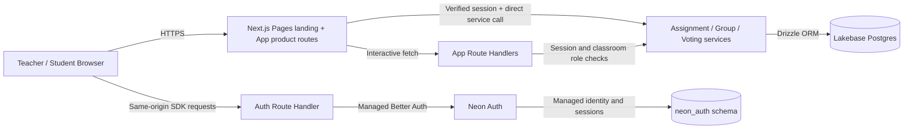

# Architecture

Managed Auth is integrated but not yet proven against a provisioned branch.
The CLI is installed; linking/enabling Auth requires the owner's Neon sign-in.
The public application schema is controlled by Drizzle migrations; Neon manages
its own auth schema. Services call the database directly, with no internal HTTP
calls from Server Components.

Teacher eligibility comes from exact managed subjects in `TEACHER_AUTH_IDS`.
Classroom membership (`INSTRUCTOR`/`STUDENT`) scopes teacher/student access to
resources. A new signup cannot choose teacher. Only a verified email identity can
claim an imported roster account. Unsigned legacy cookies are ignored unless the
explicit isolated fixture mode is enabled, and always ignored in production.

Groups and answers are assignment-scoped. One user may select one group per
assignment. Enrollment and publication lock the same assignment row, preventing
late group changes and duplicate publication. The existing max-flow engine
allocates comparisons without either compared group's members. Submitted votes
feed the existing quality-index/scoring services. Results require a classroom
teacher; a student can see their own completion counts, not scores or others' votes.

The historical classroom-group path is retained only for assignments without
scoped groups, preserving existing CSV workflows. The in-memory `/api/test/*`
fixtures are separate from the real disposable Postgres workflow verification.
They are disabled in production and are not the application's persistence layer.
