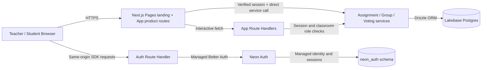

# Architecture

Product routes and HTTP boundaries live in `src/app/`. The legacy Pages
Router serves only the landing and login pages; real teacher/student work
starts at `/classrooms`.

Managed Auth is integrated but not yet proven against a provisioned branch.
The CLI is installed; linking/enabling Auth requires the owner's Neon sign-in.
The public application schema is controlled by Drizzle migrations; Neon manages
its own auth schema. Services call the database directly, with no internal HTTP
calls from Server Components.

Teacher eligibility comes from exact managed subjects in `TEACHER_AUTH_IDS`.
Classroom membership (`INSTRUCTOR`/`STUDENT`) scopes teacher/student access to
resources. A new signup cannot choose teacher. Only a verified email identity can
claim an imported roster account. Unsigned legacy cookies are ignored unless the
explicit isolated fixture mode is enabled, and always ignored in production.

Groups and answers are assignment-scoped. One user may select one group per
assignment. Enrollment and publication lock the same assignment row, preventing
late group changes and duplicate publication. Students score every
group except their own on a 1-5 scale per question; results average those
ratings. The old pairwise `pair_assignment` and `comparison` tables are kept
only for historical data. Results require a classroom
teacher; a student can see their own completion counts, not scores or others' votes.

Each assignment owns a hidden classroom whose slug is the join code, so
membership and role checks reuse `classroom_member`. Under local dev auth,
`/api/auth/dev-sign-in` accepts `role: "student"` to seed extra student accounts
for browser tests.
