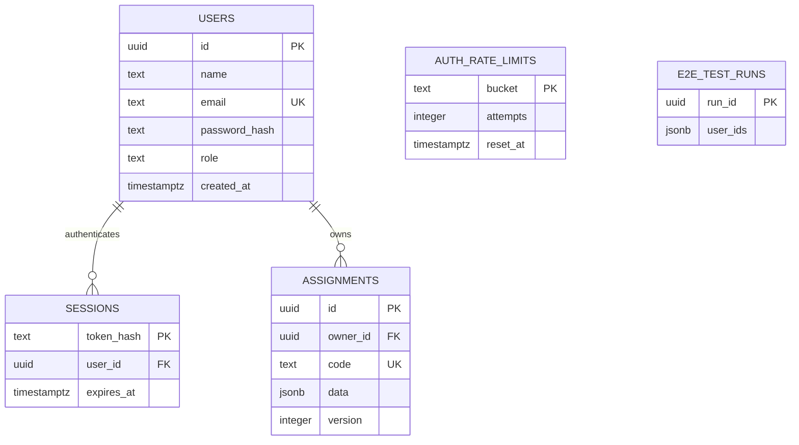
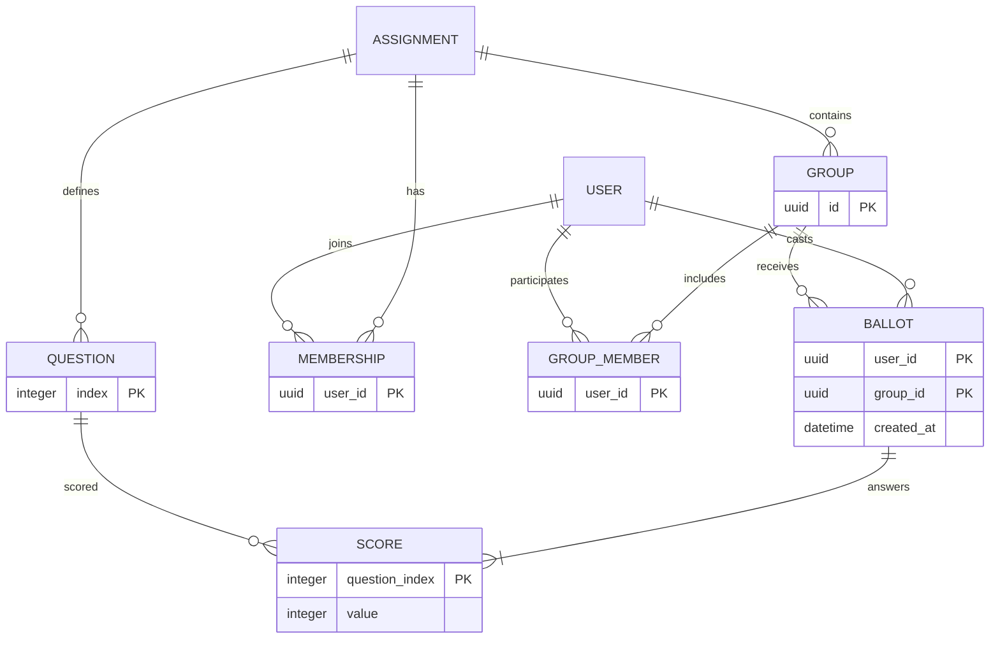

# Physical Schema and Logical Aggregate

`auth_rate_limits.bucket` is a hash of the normalized email; raw email and credentials are never logged. `e2e_test_runs` exists only to identify disposable fixture data; guarded endpoints cannot operate on production.

The following are logical entities embedded inside `assignments.data`, not physical tables:

The domain enforces one membership/group per user per assignment and uniqueness of `(user_id, group_id)` ballots under the aggregate version check. Question index is stable once voting opens. These logical constraints are not incorrectly claimed as relational foreign keys.
